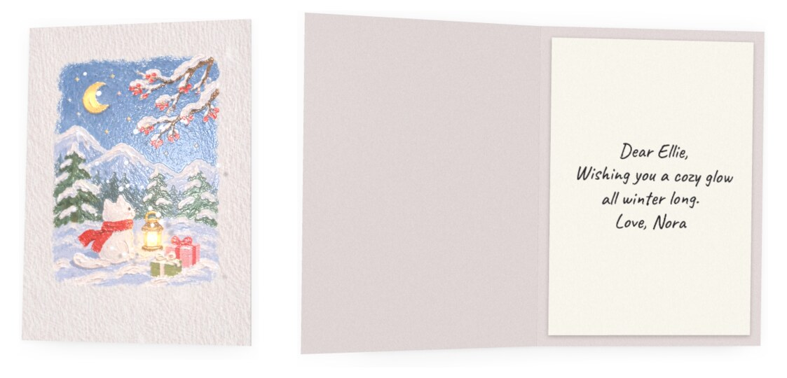

# Interactive greeting card, a skill for Claude

Give Claude a picture and a message, and it makes an interactive 3D greeting card: a folded card
on the page whose foil or thick paint catches a light that follows your pointer, that opens with
a tap to your message handwritten inside, turns over to its back, and can come alive, with
glowing lanterns, falling snow, floating hearts, and parts that sway and react when tapped.



The result is **one HTML file** with everything inside it (picture, handwriting font, renderer),
so it opens straight from a file, works offline, and can be put on any web host and shared as a
link.

## What it can do

- **Three finishes**, picked from the picture:
  - **Paint**: for paintings; the brush strokes stand up and glisten.
  - **Foil**: for illustrations and lettering; gold, silver, rose gold, copper, pink or holographic
    foil is stamped on the lines, the darks, or one colour you pick, over the whole picture or
    just a part of it (the lettering, say).
  - **Print**: for photos, optionally framed in a fine foil border.
- **A real card to handle**:
  - It sways and catches the light.
  - It opens with a tap or by pulling its edge.
  - It turns over with a drag.
  - The message is written in a hand, sized to fit.
- **Simple effects** for the occasion: snow, floating hearts, fireflies, shooting stars, foil sparkle.
- **Living cards**: Claude reads positions off a grid laid over your picture and places lights
  that flicker and flare (with rays), parts that move (tails, ears, scarves, branches, a sleeping
  animal breathing), cut-outs that stand off the paper, and taps that set things going.
- **Several cards on one page**, with a dock to switch between them, or a tour that plays itself.
- **Accessible**: keyboard controls (O opens, T turns over, the arrow keys switch cards), screen
  reader text, reduced motion, and a flat fallback without WebGL.

## Install

The skill is the [`interactive-greeting-card`](interactive-greeting-card) folder.

- **Claude.ai and the desktop app**: zip the `interactive-greeting-card` folder, then upload it in
  Settings › Capabilities › Skills. Code execution needs to be on.
- **Claude Code**: copy the folder into `~/.claude/skills/` (for you) or `.claude/skills/` (for
  one project).
- **Claude API**: upload it with the Skills API; see Anthropic's Agent Skills documentation.

To make the zip from a terminal:

```bash
cd greeting-card-skill
zip -r interactive-greeting-card.zip interactive-greeting-card -x "interactive-greeting-card/evals/*"
```

## Use it

Attach a picture and ask, in your own words:

> Turn my painting into a Christmas card for my sister Rosie. Inside: Merry Christmas, Rosie! Love, Nora.
> Make the lantern glow.

> Make a birthday card from this illustration for Theo, gold foil on the lettering. Message: Happy
> birthday Theo! xx Max

> Here are three photos from our trip. Make a set of thank-you cards, one per photo, framed in silver.

Claude picks the finish, foil and paper, writes the card's settings, builds the page and, where it
can, checks it in a browser before handing you the file.

### Sharing the card

Open the HTML file in any browser. To send it to someone, put it online: GitHub Pages, Netlify
Drop or any static host takes the file as it is. Or send the file itself.

## What's in this repository

```
interactive-greeting-card/      the skill (this is what you install)
  SKILL.md                      how Claude makes a card
  references/                   every setting, and how to make a card come alive
  scripts/make_card.py          builds the card page from its settings (Python, no dependencies)
  scripts/grid.py               a labelled grid over the picture, for placing living effects (Pillow)
  scripts/foil_preview.py       shows what turns to foil, to tune it before building (Pillow, numpy)
  scripts/snapshot.mjs          optional screenshots of a card, and what moves on it (Node, Playwright)
  assets/                       the page template, the renderer, the handwriting font, licences
  evals/                        two test cases (run them with `claude plugin eval`)
renderer/                       the renderer's source, to change and rebuild it
examples/                       finished cards, with their settings
docs/                           the picture above
```

### Changing the renderer

The renderer is plain JavaScript on [three.js](https://threejs.org), bundled into
`interactive-greeting-card/assets/greeting-card.js`. To change it:

```bash
cd renderer
npm install
npm run build
```

It's the card stage behind [bubbbly.com](https://www.bubbbly.com)'s Foil Cards and Christmas Cards,
adapted to run on a page of its own.

## Credit

If you use, remix, fork, or learn from this skill, please give credit:

- **Ann Nguyen** on X: [https://x.com/ann_nnng](https://x.com/ann_nnng)
- I vibe code with **[TypingMind](https://typingmind.com)**, my favourite tool for building with AI

A mention or a link back is enough. Thank you for keeping the credit with the work.

## Licence

MIT, see [`LICENSE`](LICENSE). It uses:

- [three.js](https://threejs.org), MIT licence: `interactive-greeting-card/assets/licenses/three.js-LICENSE.txt`.
- [Caveat](https://fonts.google.com/specimen/Caveat) by Impallari Type, SIL Open Font Licence:
  `interactive-greeting-card/assets/licenses/Caveat-OFL.txt`.
